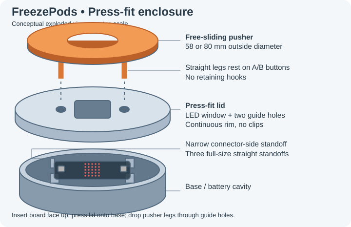

# FreezePods enclosure

A hardware-free, 3D-printable housing for a BBC micro:bit. This revision combines the V5 straight-support base, V4 press-fit lid and V6 larger pusher. Both pusher sizes fit the same lid.

## Models

| File | Purpose | Quantity per pod |
|---|---|---|
| [Base STL](FreezePods_base.stl) | Holds the micro:bit and battery pack | 1 |
| [Lid STL](FreezePods_lid.stl) | Continuous press-fit rim, LED window and two guide holes | 1 |
| [58 mm pusher STL](FreezePods_pusher_58mm.stl) | Smaller, lighter pressing surface | Choose 1 pusher |
| [80 mm pusher STL](FreezePods_pusher_80mm.stl) | Larger target for fast reaction games | Choose 1 pusher |
| [Editable OpenSCAD source](FreezePods.scad) | Parametric model for all parts | Optional |

Both pushers have a 31 mm inner opening, 4.5 mm ring thickness and identical smooth 5.5 mm legs. The 7 mm guide holes provide 0.75 mm radial clearance. No hooks, bolts, springs or inserts are needed.

## Printing

PETG is a useful starting material; PLA can also be tested. Suggested settings: 0.2 mm layer height, 0.4 mm nozzle, four walls and 20% infill. Print the base floor-down, lid outer face-down and pusher ring face-down with its legs pointing upward. Check the slicer preview before printing, especially the lid's internal shoulder. Print one pod first.

## Assembly

1. Place the battery pack in the base, connect it to the micro:bit and route the wire without pinching it.
2. Seat the board LED face up, USB toward the top. The connector-side standoff is narrowed to clear the beige battery socket on the underside. The other three standoffs retain their original footprint; all four are straight and supported from the floor.
3. Press the lid onto the base until its internal shoulder seats on the rim.
4. Lower either pusher into the two guide holes from above. The legs should slide freely and rest on the A/B buttons without activating them.
5. Test gentle taps at different points around the ring. Confirm the button springs return the pusher and neither button stays activated.

## Dimensions and customization

All dimensions are in mm. The base is 90 mm in diameter; the lid is 95 mm. The nominal board pocket is 53.2 × 43.2 mm. Three supports are 8 × 8 mm and the connector-side support is 4.2 × 8 mm before the board pocket is cut. Nominal lid radial clearance is 0.1 mm; nominal pusher travel is 0.65 mm.

Open the source in [OpenSCAD](https://openscad.org/). Choose `part="base"`, `part="lid"` or `part="pusher"`, set `ring_od=58` or `ring_od=80` for the pusher, render (F6) and export STL. The default assembly preview uses the 80 mm pusher. Adjust fit, connector-side support width, button height and travel for your actual board and printer.

## Prototype notes

Physical fit, switch return, connector clearance and press-fit tolerance have not yet been confirmed. The larger ring gives about 2.3 times the nominal pressing area, but may rock or bind more under off-center loading and may weigh enough to preload the switches. Test both sizes before making a batch. Do not force the buttons or lid. The board dimensions were based on a V1.5 drawing; the connector-side change was informed by a V2 board photo. Verify actual board revision and switch dimensions.

[Back to the game lab](../README.md)
